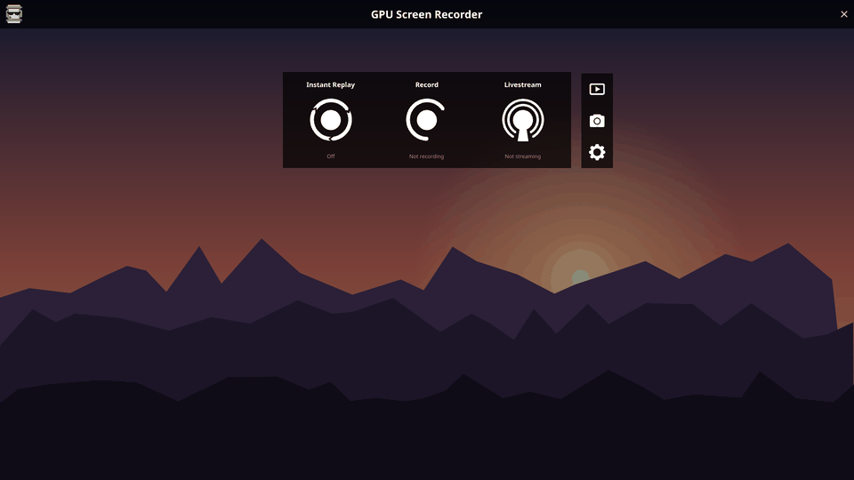
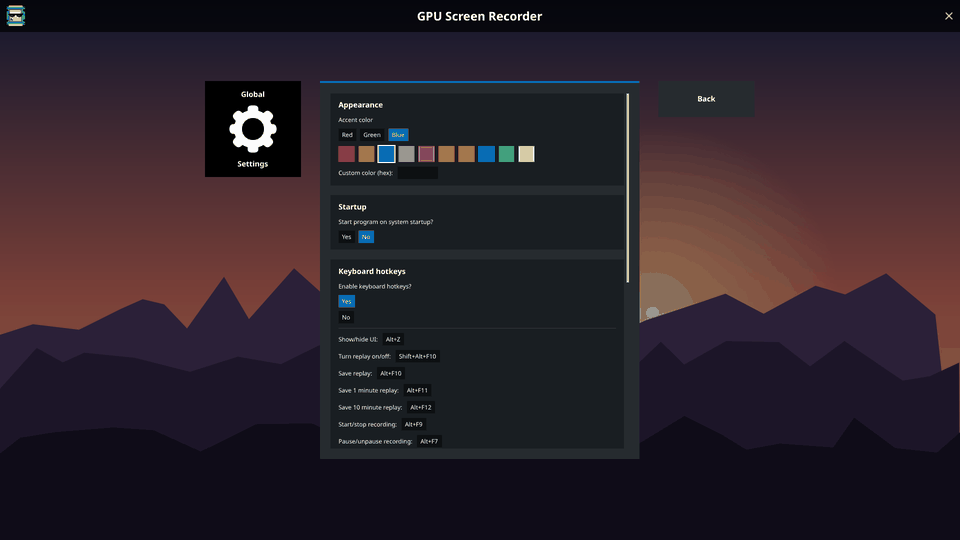
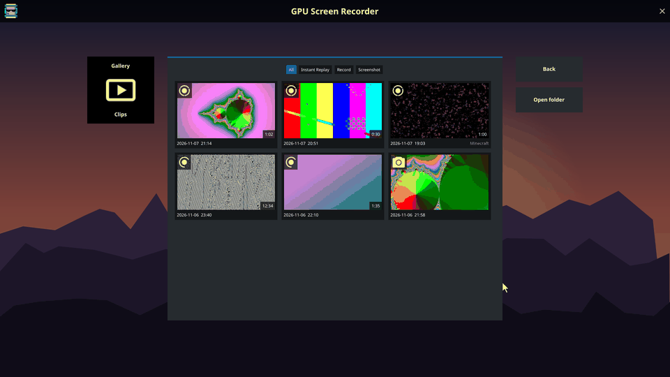
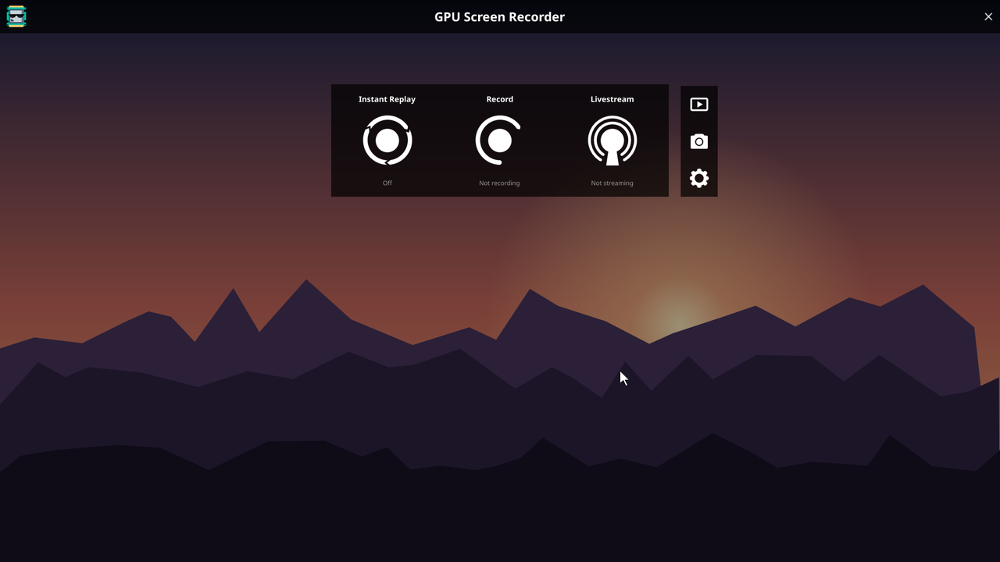
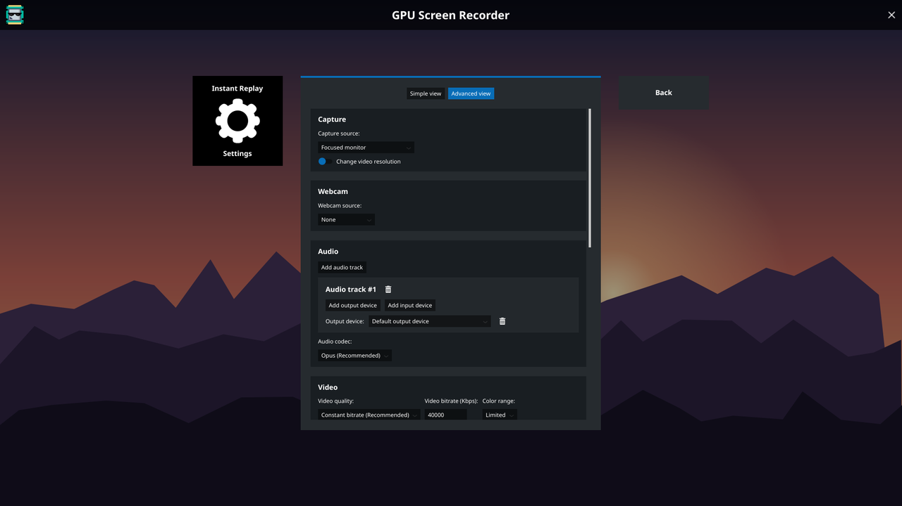
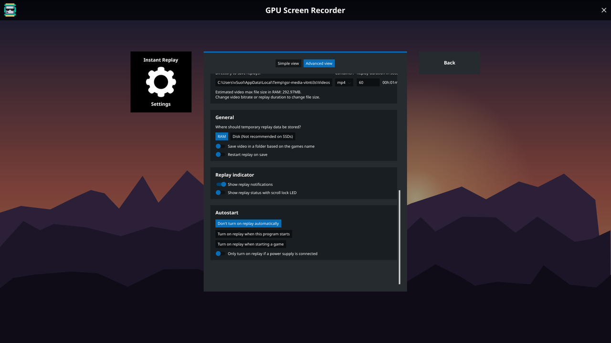
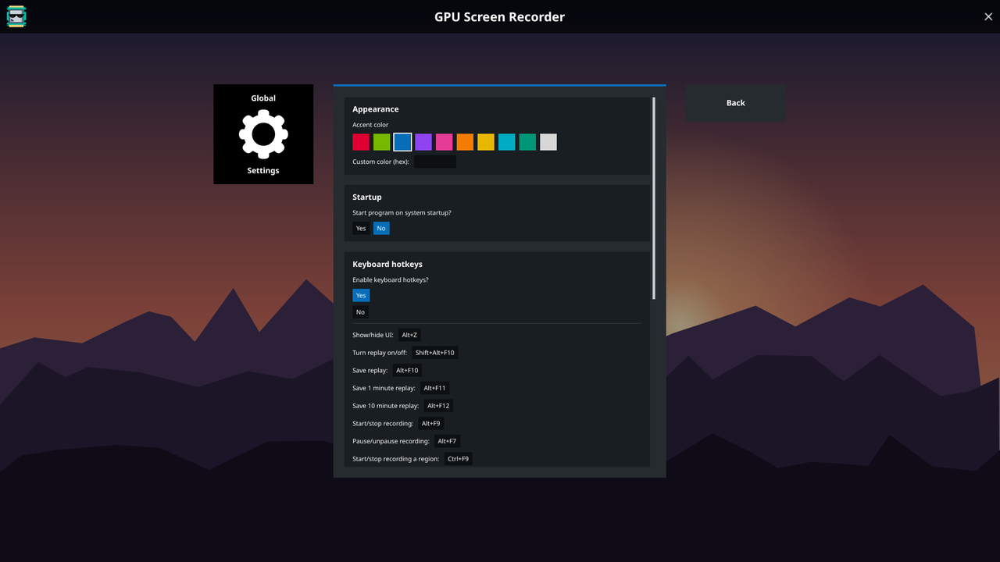
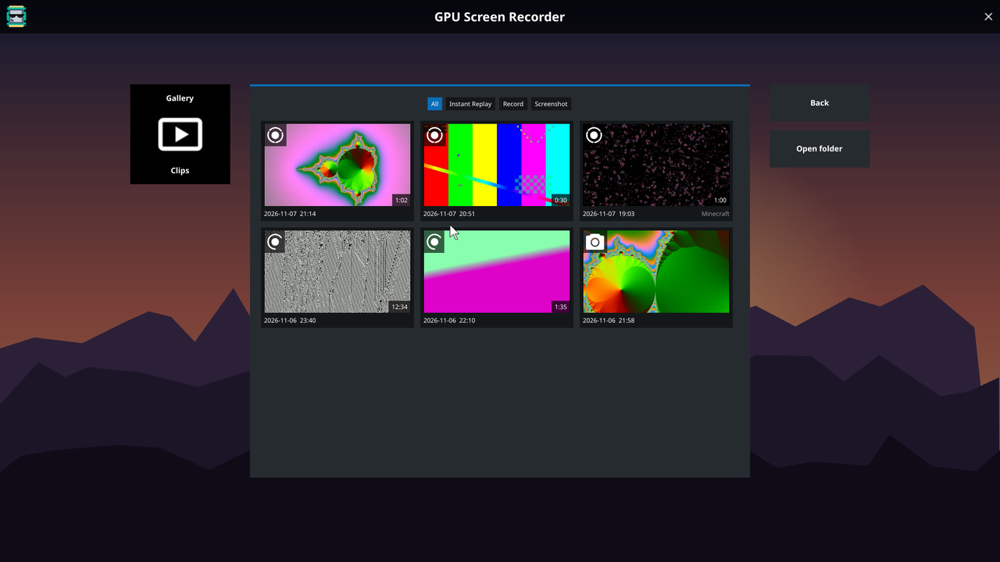
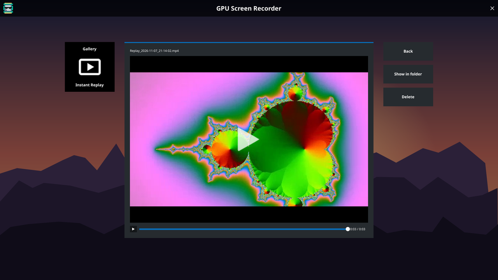

# GPU Screen Recorder UI for Windows (unofficial port)

A Windows port of the [GPU Screen Recorder](https://git.dec05eba.com/gpu-screen-recorder-ui/) UI by dec05eba:
the ShadowPlay-style **Alt+Z overlay** with instant replay, recording, livestreaming and screenshots, with
the same look, controls, settings and notifications as the Linux version, plus a clip gallery and extra
accent colors.

> This is an independent, unofficial port. It is not affiliated with or endorsed by dec05eba.
> Report Windows-specific bugs here, not upstream.

<p align="center"></p>

| Notifications (port of gsr-notify) | Accent colors |
|---|---|
|  |  |

<p align="center"></p>

<details>
<summary>More screenshots</summary>

| | |
|---|---|
|  |  |
|  |  |
|  |  |

</details>

## Features

- Alt+Z fullscreen overlay with the original layout, icons and settings pages
- **Instant replay** (save last N seconds, 1 min, 10 min), **recording** with pause, **livestreaming**
  (Twitch, YouTube, Rumble, Kick, custom RTMP), **screenshots**
- Capture a monitor, a region, or a single window (follows the window when it moves or is covered)
- Up to your monitor's refresh rate (60/120/144/165 fps), no capture border, ~1% CPU
- GPU encoding on the GPU that drives the display: Intel QuickSync (zero-copy), NVIDIA NVENC, AMD AMF;
  CPU fallback (x264)
- H.264 / HEVC / AV1 (whatever your GPU supports), CBR or quality-based
- Multiple audio tracks: any output device (loopback) and any microphone, mixed per track
- Webcam overlay with drag-to-place preview
- **Gallery**: browse saved replays, recordings and screenshots as thumbnails, filter by type, and play
  them inside the overlay (seek bar, Space to pause, arrow keys to skip 5 s); delete goes to the Recycle Bin.
  Clips saved by NVIDIA ShadowPlay / the NVIDIA app show up too (read from its configured capture folder,
  `Videos\NVIDIA` by default)
- **Accent colors**: pick a color box (red, green, blue, purple, pink, orange, yellow, cyan, teal, white) or
  type any `#rrggbb` color (Settings → Appearance)
- gsr-notify style notifications, global hotkeys, autostart, start replay on launch / when a game starts
- Translations from upstream

## Requirements

- Windows 10 2004 or newer, 64-bit
- A GPU with a hardware encoder is recommended

## Install

Download **`GPU-Screen-Recorder-Setup.exe`** from the [latest release](https://github.com/vsoultann/gsr-ui-windows/releases/latest)
and run it. It installs for your user only (no admin prompt) to `%LOCALAPPDATA%\Programs\GPU Screen Recorder`,
adds a Start Menu shortcut and optionally a desktop shortcut and start with Windows. Uninstall from
Settings → Apps; your clips and settings are kept.

Prefer no installer? Download the zip instead, extract it and run `GPU Screen Recorder.exe`.
Run it with `launch-daemon` to start hidden in the background; press **Alt+Z** to open the UI.

Clips are saved to your Videos folder (`Replay_*.mp4`, `Video_*.mp4`), screenshots to Pictures.

> **NVIDIA users:** the NVIDIA overlay uses the same default hotkeys (Alt+Z, Alt+F9, Alt+F10, Alt+Shift+F10).
> Turn it off in the NVIDIA App (Settings → Features → NVIDIA Overlay) or change the hotkeys in
> Settings → Keyboard hotkeys. The app tells you when a hotkey is taken.

## Run from source

```
pip install -r requirements.txt
python main.py
```

FFmpeg 8.0 or newer is required (`ddagrab`, `gfxcapture`). The app looks for `ffmpeg.exe` next to itself, then on `PATH`
(`winget install Gyan.FFmpeg`).

## Build

```
powershell -ExecutionPolicy Bypass -File build.ps1
```

Produces `dist\GPU Screen Recorder\` with `ffmpeg.exe` bundled.

```
powershell -ExecutionPolicy Bypass -File build_installer.ps1
```

Builds the app, then `dist-installer\GPU-Screen-Recorder-Setup.exe` (`installer/installer.py`).

## How it works

| Linux upstream | This port |
|---|---|
| mgl/OpenGL widget toolkit | `gsr/gui.py`: the same widgets re-implemented with Qt (PySide6), same proportions |
| gpu-screen-recorder (KMS/NvFBC capture, VAAPI/NVENC) | `gsr/engine.py`: FFmpeg with `ddagrab` (DXGI Desktop Duplication; `gfxcapture` for single windows); QSV/NVENC/AMF encoders |
| PipeWire/PulseAudio | `gsr/audio.py`: WASAPI loopback/microphone capture, streamed to FFmpeg through named pipes |
| gsr-notify | `gsr/notify.py`: port of gsr-notify's layout and animation |
| evdev/X11 global hotkeys | `gsr/hotkeys.py`: `RegisterHotKey` |

Developer tools in `tools/`: logic self-test (`selftest.py`), offscreen UI renders (`render_test.py`,
`notify_render.py`), README media (`make_media.py`), engine tests (`engine_test.py`), frame-timing analysis of a
clip (`analyze_clip.py`), stall test (`stall_test.py`), performance/quality/streaming checks (`perf_test.py`),
player checks (`player_test.py`), whole-app CPU/RAM (`app_usage.py`), game-fps cost (`game_cost.py` with the
offscreen GPU load `gpu_load.py`).

## Performance

Measured on a laptop (Intel iGPU driving the display with QSV encoding, RTX 2050, Windows 10, 1568x1080):

| | CPU (whole machine) | RAM |
|---|---|---|
| Idle in the background | 0.2 % | 28 MB |
| Replay buffer on, 60 fps | 0.4 % | ~200 MB (most of it is ffmpeg's GPU encoder) |
| Recording 120 fps / 144 fps | under 0.5 % | ~210 MB |
| NVIDIA NVENC option while the display runs on the Intel iGPU, 60 / 120 fps | 1.4 / 3.3 % | ~700 MB (frames cross GPUs through system memory; Auto/QSV is lighter here) |
| Software x264 (not recommended) | 6-9 % | ~750 MB |
| Playing a clip in the gallery | 2.2 % | +20 MB |

- Frame rate is exact: 30/60/120/144 fps recordings have the requested number of frames with no gaps.
- Quality presets scale as expected (about 3.8 / 6.9 / 10.8 / 15.7 Mbps at 1080p60 for medium / high /
  very high / ultra on busy content). Custom bitrate lands within 3 % of the target on busy content;
  static scenes use less.
- Streaming (tested end to end over RTMP): 60 and 120 fps arrive exact, bitrate on target, AAC audio.
- A GPU-bound test "game" showed no measurable frame-rate loss while recording (the difference was
  smaller than run-to-run noise).

## Differences from Linux

- Single-window capture uses Windows Graphics Capture, which draws a yellow border around that window on
  Windows 10 (not on Windows 11). Monitor and region capture have no border.
- To capture above ~64 fps the app raises the timer resolution inside its own ffmpeg child process
  (`timeBeginPeriod(1)` via a remote thread); some antivirus tools may flag that technique.
- "RAM" replay storage writes to a temp folder (Windows has no tmpfs).
- Saved replays can be up to ~2 s longer than requested (cut on 2 s keyframe boundaries).
- Resuming a paused recording loses about 1 second.
- Not available on Windows: per-application audio, controller hotkeys, HDR/10-bit, Vulkan encoding,
  desktop portal. These options are hidden, the same way upstream hides unsupported options.
- The overlay menu and notifications show up in recordings while they are on screen: Windows 10 can't
  exclude translucent windows from capture.
- Exclusive-fullscreen games may not be capturable and the overlay can't draw over them; use borderless windowed.
- Alt-tabbing into or out of a fullscreen game (or a UAC prompt) makes Windows reset desktop capture.
  The app restarts capture right away, but about 1 second around the switch is missing from the clip.

## License

GPL-3.0, same as upstream (see `LICENSE`). Images and translations are from
[gpu-screen-recorder-ui](https://git.dec05eba.com/gpu-screen-recorder-ui/) and
[gpu-screen-recorder-notification](https://git.dec05eba.com/gpu-screen-recorder-notification/) by dec05eba
and contributors. Noto Sans is licensed under the SIL Open Font License (`gsr/fonts/OFL.txt`).
FFmpeg (bundled in releases) is licensed under the GPL; see https://ffmpeg.org/legal.html.
